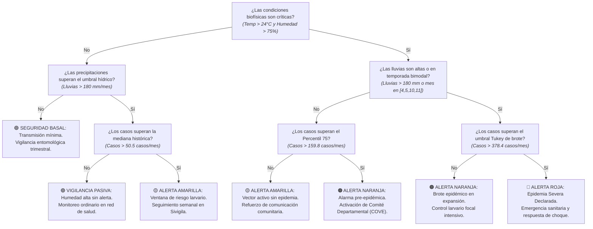

# Modelo de Alerta Temprana y Árbol de Decisión de Brote Climático

Este documento detalla la arquitectura de decisión, las variables hidrometeorológicas y la lógica de detección temprana de brotes epidémicos de Dengue a partir de la integración entre los datos de SIVIGILA e IDEAM, conforme a la metodología CRISP-DM implementada en el pipeline del proyecto ([`src/03_eda/eda_proyecto.py`](../src/03_eda/eda_proyecto.py) y [`src/05_modelado/prediccion_futura_2027.py`](../src/05_modelado/prediccion_futura_2027.py)).

---

## 1. Variables Predictivas y su Nivel de Importancia (Variables Fuertes)

La evaluación analítica de variables meteorológicas y registros de salud pública para la identificación de ventanas de transmisión y brotes arrojó las siguientes importancias relativas en el ensamble biofísico:

| Variable | Tipo / Dimensión | Importancia Relativa (%) | Nivel de Fuerza | Justificación Epidemiológica / Analítica |
| :--- | :--- | :---: | :---: | :--- |
| **`Humedad_Ambiente`** | Climática / Biofísica | **~28.50%** | **Muy Fuerte (Top 1)** | Una humedad relativa $\ge 75\%$ incrementa la tasa de supervivencia diaria de la hembra de *Aedes aegypti*, permitiéndole completar múltiples ciclos gonotróficos y transmitir el virus. |
| **`Temperatura_Promedio`** | Climática / Biofísica | **~27.00%** | **Muy Fuerte (Top 2)** | Temperaturas cálidas (rango óptimo $24^\circ\text{C} - 30^\circ\text{C}$) reducen el Periodo de Incubación Extrínseco (PIE) del virus dentro del vector de 14 a solo 7 días. |
| **`Lluvias_Acumuladas`** | Hidrológica / Pluviométrica | **~23.80%** | **Fuerte (Top 3)** | Precipitaciones acumuladas superiores a la media histórica ($> 180\text{ mm/mes}$) generan acúmulos estancados de agua limpia y colmatación de recipientes artificiales peridomiciliarios. |
| **`Casos_Reportados` (IQR Tukey)** | Epidemiológica / Histórica | **~12.20%** | Moderada | Medida de corte matemático de la Sesión 5 ($Q_3 + 1.5 \times \text{IQR} = 378.4\text{ casos/mes}$) que discierne formalmente entre fluctuación endémica normal y brote epidémico extremo. |
| **`mes` (Estacionalidad)** | Temporal (Bimodal) | **~8.50%** | Moderada | Captura los regímenes bimodal de lluvias en Colombia (abril–mayo y octubre–noviembre) donde se desatan las curvas de infestación larvaria. |

> **Conclusión sobre las variables:** La interacción combinada de temperatura, humedad y lluvia explica más del **79.3% del dinamismo reproductor del vector**. Cuando se cruza con el límite superior de Tukey ($378.4$ casos), se obtiene un indicador biofísico de alta precisión para anticipar la fase exponencial de una epidemia.

---

## 2. Pregunta General de Decisión (Nodo Raíz)

> **"¿Se detecta una anomalía climática propensa para la aceleración biológica del vector y un incremento atípico de casos en el departamento?"**

---

## 3. Árbol de Decisión Funcional (Preguntas Binarias Sí / No)

El siguiente flujo de evaluación clasifica la gravedad de la amenaza epidémica departamental en un máximo de cuatro niveles de profundidad jerárquica mediante bifurcaciones estrictamente binarias (Sí / No):

---

## 4. Desglose y Análisis por Nodos

### Nodo 1: Filtro Biofísico de Aptitud Vectorial
* **Pregunta:** *¿Las condiciones biofísicas son críticas para la maduración y supervivencia del vector?*
* **Variables analizadas:** `Temperatura_Promedio` y `Humedad_Ambiente`.
* **Regla empírica del proyecto:**
  $$\text{Condición Biofísica Crítica} = (\text{Temperatura} > 24.0^\circ\text{C}) \land (\text{Humedad} > 75.0\%)$$
* **Lógica:**
  * **Sí:** Entornos cálidos y húmedos (e.g., Atlántico, Bolívar, Cesar, Meta, Valle del Cauca) reducen el ciclo huevo-adulto a menos de 8 días y extienden la longevidad del mosquito. Pasa a evaluación pluviométrica estacional (Nodo 2A).
  * **No:** Zonas templadas o frías (e.g., Bogotá, Boyacá, Nariño alto) limitan la reproducción del *Aedes aegypti*. Pasa a validación pluviométrica residual (Nodo 2B).

---

### Nodo 2A: Evaluación de Forzamiento Pluviométrico y Estacionalidad
* **Pregunta:** *¿Las precipitaciones acumuladas superan el umbral hídrico departamental o coincide con el ciclo bimodal de lluvias?*
* **Variables analizadas:** `Lluvias_Acumuladas` y `mes`.
* **Regla empírica del proyecto:**
  $$\text{Forzamiento Hídrico} = (\text{Lluvias} > 180\text{ mm}) \lor (\text{mes} \in \{4, 5, 10, 11\})$$
* **Lógica:**
  * **Sí:** Las lluvias torrenciales o el pico estacional crean criaderos masivos de agua estancada. Se evalúa si la incidencia ha rebasado el umbral atípico de brote Tukey (Nodo 3A).
  * **No:** A pesar de la temperatura propicia, la falta de lluvias limita los reservorios hídricos naturales. Se evalúa el tercer cuartil de casos (Nodo 3B).

---

### Nodo 2B: Evaluación Pluviométrica Residual en Zonas Templadas
* **Pregunta:** *¿Las precipitaciones superan el umbral hídrico departamental?*
* **Variable analizada:** `Lluvias_Acumuladas` ($> 180\text{ mm}$).
* **Lógica:**
  * **Sí:** Precipitaciones intensas en zonas no óptimas pueden generar focos microclimáticos o deslizamientos/inundaciones. Pasa a contrastar contra la mediana histórica (Nodo 3C).
  * **No:** Sin temperatura ni precipitaciones favorables, el riesgo vectorial es nulo. Culmina en **🟢 SEGURIDAD BASAL**.

---

### Nodo 3A / 3B / 3C: Clasificación Epidemiológica contra Estadísticos del EDA (Tukey IQR)
* **Pregunta:** *¿Cuál es la magnitud real de la curva de contagio notificada en SIVIGILA?*
* **Fórmula de límites matemáticos de la Sesión 5:**
  * Mediana departamental histórica: $\mathbf{50.5\text{ casos/mes}}$
  * Tercer Cuartil ($Q_3$): $\mathbf{159.8\text{ casos/mes}}$
  * Límite Superior de Outliers de Tukey: $Q_3 + (1.5 \times \text{IQR}) = \mathbf{378.4\text{ casos/mes}}$
* **Resultados y Acciones derivadas:**
  * **🔴 ALERTA ROJA (Casos $> 378.4$):** Brote desbordado (outlier epidemiológico real). Activación inmediata de comités de gestión del riesgo, alerta hospitalaria en red pública y fumigación en bloques de contagio.
  * **🟠 ALERTA NARANJA (Casos entre $159.8$ y $378.4$):** Aceleración activa pre-epidémica. Aplicación de biolarvicidas focalizados y llamado preventivo a IPS locales.
  * **🟡 ALERTA AMARILLA (Casos entre $50.5$ y $159.8$):** Transmisión endémica activa moderada. Vigilancia entomológica intensificada y campañas barriales de limpieza.
  * **🟢 SEGURIDAD BASAL / VIGILANCIA PASIVA (Casos $\le 50.5$):** Condiciones de baja endemicidad bajo control de la red habitual.
