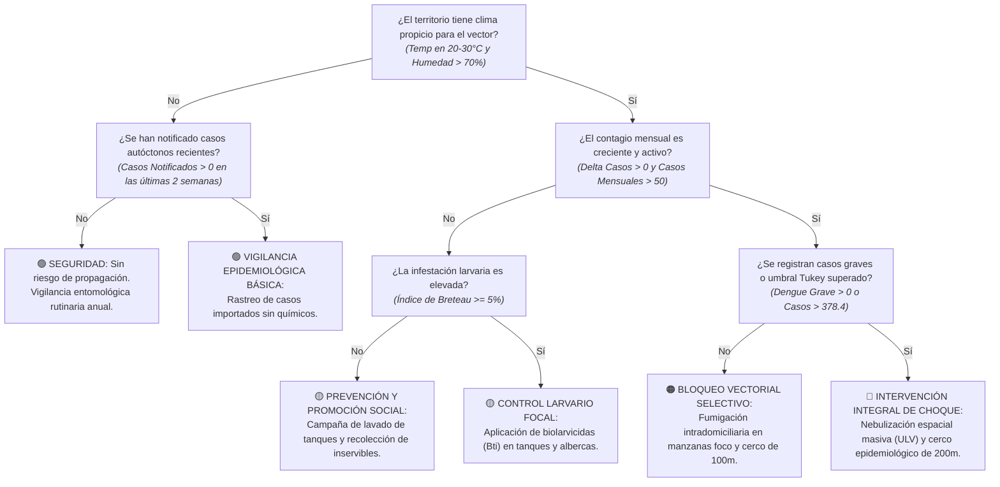

# Modelo de Intervención en Campo y Árbol de Decisión de Control Vectorial

Este documento detalla la arquitectura de decisión, las variables entomológicas y operativas, y la lógica de priorización territorial para el despliegue de brigadas de salud pública (control biolarvario, fumigación espacial y movilización comunitaria) conforme a las alertas epidemiológicas generadas en el proyecto ([`src/06_visualizacion/mapa_riesgo_interactivo.py`](../src/06_visualizacion/mapa_riesgo_interactivo.py)).

---

## 1. Variables Predictivas y su Nivel de Importancia (Variables Fuertes)

La priorización de cuadrantes y municipios para el despliegue de brigadas de intervención vectorial se fundamenta en las siguientes variables biofísicas y operativas:

| Variable | Tipo / Dimensión | Importancia Relativa (%) | Nivel de Fuerza | Justificación Epidemiológica / Analítica |
| :--- | :--- | :---: | :---: | :--- |
| **`Índice_Breteau` (Densidad Larvaria)** | Entomológica / Vectorial | **~30.60%** | **Muy Fuerte (Top 1)** | Porcentaje de recipientes positivos con larvas o pupas de *Aedes aegypti* por cada 100 viviendas inspeccionadas. Índices $\ge 5\%$ indican alto riesgo de transmisión comunitaria. |
| **`Velocidad_Propagación`** ($\Delta \text{Casos}$) | Dinámica Epidemiológica | **~26.20%** | **Muy Fuerte (Top 2)** | Tasa de aceleración calculada como $\text{Casos}_{t} - \text{Casos}_{t-1}$. Incrementos positivos sostenidos señalan que el brote está en fase exponencial y requiere control del mosquito adulto. |
| **`Aptitud_Bioclimática_Vector`** | Climática / Biofísica | **~22.40%** | **Fuerte (Top 3)** | Rango térmico ($20^\circ\text{C} - 30^\circ\text{C}$) y humedad ($\ge 70\%$) que favorecen el ciclo reproductivo y vuelo del mosquito en el municipio evaluado. |
| **`Casos_Graves_o_Tukey`** | Severidad Clínica | **~12.80%** | Moderada | Presencia de Dengue con Signos de Alarma o casos acumulados mensuales superiores al umbral Tukey ($> 378.4\text{ casos}$), que ameritan bloqueo químico peridomiciliario. |
| **`Déficit_Acueducto_Almacenamiento`** | Social / Infraestructura | **~8.00%** | Moderada | Proporción de viviendas sin cobertura de agua continua que recurren a tanques, albercas y canecas expuestas a la intemperie. |

> **Conclusión sobre las variables:** La densidad larvaria y la velocidad de contagio dominan el **56.8% del criterio de asignación de brigadas**. El control oportuno de larvas evita la emergencia masiva de adultos infectantes, minimizando el uso indiscriminado de insecticidas químicos.

---

## 2. Pregunta General de Decisión (Nodo Raíz)

> **"¿Debe la Secretaría de Salud departamental desplegar brigadas de control químico, larvario y movilización social en el municipio o comuna?"**

---

## 3. Árbol de Decisión Funcional (Preguntas Binarias Sí / No)

A continuación se presenta el árbol de decisión funcional para la asignación de recursos y brigadas en terreno, estructurado en un máximo de cuatro niveles con preguntas binarias (Sí / No):

---

## 4. Desglose y Análisis por Nodos

### Nodo 1: Verificación de Idoneidad Bioclimática Vectorial
* **Pregunta:** *¿El territorio presenta condiciones ambientales que permitan el ciclo de vida del Aedes aegypti?*
* **Variables analizadas:** `Temperatura_Promedio` ($20^\circ\text{C} \le T \le 30^\circ\text{C}$) y `Humedad_Ambiente` ($> 70\%$).
* **Lógica:**
  * **Sí:** Municipios situados a menos de 2,200 msnm con clima cálido o templado presentan aptitud vectorial plena. Pasan al análisis de la dinámica de contagio (Nodo 2A).
  * **No:** Zonas de páramo o alta montaña (e.g., Bogotá) donde la temperatura inhibe biológicamente el desarrollo del vector. Pasan a control pasivo de casos importados (Nodo 2B).

---

### Nodo 2A: Evaluación de Aceleración y Magnitud del Contagio
* **Pregunta:** *¿El contagio mensual es creciente y supera el nivel basal de la región?*
* **Regla analítica:**
  $$\text{Expansión Activa} = (\Delta \text{Casos} = \text{Casos}_{t} - \text{Casos}_{t-1} > 0) \land (\text{Casos}_{t} > 50.5\text{ [Mediana]})$$
* **Lógica:**
  * **Sí:** La transmisión está acelerándose y existe alta probabilidad de diseminación vecinal. Se evalúa la gravedad clínica del brote (Nodo 3A).
  * **No:** Casos estables o por debajo de la mediana típica departamental. Se evalúa la infestación larvaria preventiva (Nodo 3B).

---

### Nodo 2B: Rastreo de Casos Aislados en Zonas No Óptimas
* **Pregunta:** *¿Se han reportado casos autóctonos en las últimas dos semanas?*
* **Lógica:**
  * **Sí:** Indica posible microclima focal o pacientes con antecedentes de viaje reciente infectados fuera del territorio. Se ejecutan visitas de investigación médica sin necesidad de químicos (**🟢 VIGILANCIA EPIDEMIOLÓGICA BÁSICA**).
  * **No:** Sin vector ni casos reportados. Concluye en **🟢 SEGURIDAD: Sin riesgo de propagación**.

---

### Nodo 3A / 3B: Diagnóstico Entomológico y Tipo de Despliegue en Campo
* **Lógica y Protocolos de Respuesta Territorial:**
  * **Infestación Larvaria ($\text{Índice Breteau} \ge 5\%$):** Si más de 5 de cada 100 viviendas tienen recipientes con larvas, se activa **🟡 CONTROL LARVARIO FOCAL** desplegando promotores de salud para aplicar biolarvicidas bacterianos biológicos (*Bacillus thuringiensis israelensis - Bti*). Si el índice es menor a 5%, se orientan las acciones a **🟡 PREVENCIÓN Y PROMOCIÓN SOCIAL** (educación escolar, jornadas de reciclaje de llantas y lavado con cepillo de albercas).
  * **Brote Severo / Casos Graves ($\text{Casos} > 378.4$ o Dengue Grave $> 0$):** Si se sobrepasa el límite matemático de Tukey ($378.4$ casos/mes) o se confirman casos con extravasación de plasma y choque, se declara la **🔴 INTERVENCIÓN INTEGRAL DE CHOQUE** (nebulización espacial en frío con motomochilas o camionetas ULV en toda la comuna, cerco de 200 metros alrededor de los casos índice y recolección forzosa de criaderos). Si no hay signos de gravedad, se limita a **🟠 BLOQUEO VECTORIAL SELECTIVO** con rociado intradomiciliario de acción residual en las manzanas focales.
