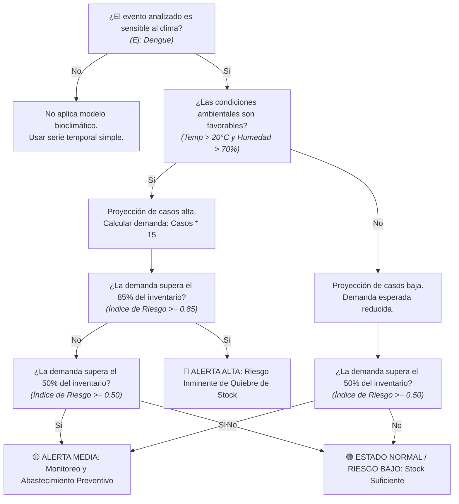

# Modelo Predictivo y Árbol de Decisión de Desabastecimiento

Este documento detalla la arquitectura de decisión, las variables de influencia y la lógica funcional del modelo predictivo implementado en [`src/05_modelado/prediccion_futura_2027.py`](../src/05_modelado/prediccion_futura_2027.py).

---

## 1. Variables Predictivas y su Nivel de Importancia (Variables Fuertes)

El modelo supervisado de predicción (`RandomForestRegressor` entrenado sobre los registros de SIVIGILA y climatología) arrojó las siguientes importancias relativas (`feature_importances_`):

| Variable | Tipo / Dimensión | Importancia Relativa (%) | Nivel de Fuerza | Justificación Epidemiológica / Analítica |
| :--- | :--- | :---: | :---: | :--- |
| **`Humedad_Ambiente`** | Climática / Biofísica | **~27.49%** | **Muy Fuerte (Top 1)** | Aumenta la longevidad y supervivencia del mosquito vector hembra (*Aedes aegypti*). |
| **`Temperatura_Promedio`** | Climática / Biofísica | **~26.40%** | **Muy Fuerte (Top 2)** | Temperaturas cálidas (20 °C – 30 °C) aceleran la replicación viral y reducen el ciclo de desarrollo larvario. |
| **`Lluvias_Acumuladas`** | Climática / Biofísica | **~24.30%** | **Fuerte (Top 3)** | Favorece la creación de criaderos naturales y acumulación de agua estancada. |
| **`ANO`** | Temporal (Multianual) | **~11.84%** | Moderada | Explica la tendencia histórica de crecimiento poblacional y ciclos interanuales epidémicos. |
| **`mes`** | Temporal (Estacional) | **~9.97%** | Moderada | Captura los regímenes bimodal de lluvias/sequía en el calendario colombiano. |

> **Conclusión sobre las variables:** El **bloque climático acumula el ~78.2% del poder predictivo** del modelo, confirmando que las condiciones bioclimáticas son los factores determinantes para disparar la curva de casos.

---

## 2. Pregunta General de Decisión (Nodo Raíz)

> **"¿Existe riesgo de desabastecimiento de medicamentos en el departamento para el periodo evaluado?"**

---

## 3. Árbol de Decisión Funcional (Preguntas Binarias Sí / No)

A continuación se presenta el flujo completo de evaluación de riesgo que integra el modelo de Machine Learning (`RandomForestRegressor`) con las reglas de negocio de logística hospitalaria:

---

## 3. Desglose y Análisis por Nodos

### Nodo 1: Segmentación por Tipo de Patología
* **Pregunta:** *¿El evento de salud pública es sensible al clima?*
* **Variable analizada:** `Nombre_evento` (en el dataset CRISP-DM).
* **Lógica:**
  * **Sí:** Se aísla el evento objetivo (**Dengue** como caso de estudio principal) y se activa el modelo bioclimático.
  * **No:** Se descarta el análisis climático, ya que eventos como agresiones o desnutrición no responden al ciclo biológico de vectores como el *Aedes aegypti*.

---

### Nodo 2: Evaluación Biofísica (Machine Learning)
* **Pregunta:** *¿Las condiciones climáticas favorecen un brote epidémico?*
* **Variables predictivas y su importancia relativa (`feature_importances_`):**
  * **`Humedad_Ambiente` (~27.49%):** Variable determinante. Una humedad superior al 70% prolonga la supervivencia del mosquito adulto transmisor.
  * **`Temperatura_Promedio` (~26.40%):** Rango óptimo entre 20 °C y 30 °C que acelera el ciclo reproductivo del vector y la replicación viral.
  * **`Lluvias_Acumuladas` (~24.30%):** Inductor de criaderos naturales y artificiales de larvas.
  * **`ANO` (~11.84%):** Captura tendencias de crecimiento interanual.
  * **`mes` (~9.97%):** Captura la estacionalidad intra-anual (regímenes bimodal y seco).
* **Resultado del nodo:** Estimación numérica de `Casos_Reportados` mediante ensamble de árboles de decisión.

---

### Nodo 3: Estimación de la Demanda Sanitaria
* **Pregunta:** *¿Cuál es el volumen de insumos médicos necesarios?*
* **Fórmula de conversión logística:**
  $$\text{Demanda de Medicamentos} = \text{Casos Predichos} \times 15$$
  *(Donde 15 unidades representa el requerimiento terapéutico promedio por paciente de Dengue: sales de rehidratación oral, antipiréticos, analgesia y analítica).*

---

### Nodo 4: Clasificación del Riesgo de Desabastecimiento
* **Pregunta:** *¿La demanda proyectada compromete la capacidad de respuesta instalada?*
* **Cálculo del Índice:**
  $$\text{Índice de Riesgo} = \frac{\text{Demanda Predicha}}{\text{Inventario Disponible}}$$
* **Clasificación final:**
  * **`Índice >= 0.85` (ALTO - Rojo):** Demanda en zona crítica ($\ge 85\%$ de la capacidad). Se activan compras de emergencia o transferencias interdepartamentales.
  * **`0.50 <= Índice < 0.85` (MEDIO - Amarillo):** Demanda moderada a elevada. Se recomienda abastecimiento preventivo.
  * **`Índice < 0.50` (BAJO - Verde):** Inventario departamental holgado frente a la demanda estimada.
