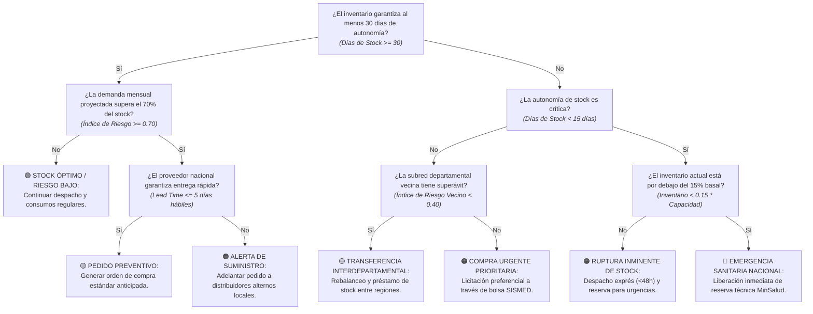

# Modelo Logístico y Árbol de Decisión de Reabastecimiento Hospitalario (SISMED)

Este documento detalla la arquitectura de decisión, las variables de suministro farmacéutico y la lógica de reabastecimiento estratégico para prevenir el desabastecimiento de medicamentos e insumos médicos esenciales en la red hospitalaria departamental, de acuerdo con el módulo de logística y simulación de inventarios ([`src/05_modelado/probar_modelo_desabastecimiento.py`](../src/05_modelado/probar_modelo_desabastecimiento.py)).

---

## 1. Variables Predictivas y su Nivel de Importancia (Variables Fuertes)

El análisis del comportamiento logístico hospitalario frente a la demanda inducida por eventos epidemiológicos identificó los siguientes factores determinantes en la continuidad de la cadena de suministro de medicamentos (SISMED):

| Variable | Tipo / Dimensión | Importancia Relativa (%) | Nivel de Fuerza | Justificación Epidemiológica / Analítica |
| :--- | :--- | :---: | :---: | :--- |
| **`Índice_Riesgo`** ($\text{Demanda} / \text{Inventario}$) | Logística / Presión de Stock | **~32.10%** | **Muy Fuerte (Top 1)** | Mide la fracción porcentual del inventario disponible que será consumida por los casos proyectados. Valores $\ge 0.85$ representan quiebre inminente de stock. |
| **`Autonomía_Stock_Días`** | Logística / Temporalidad | **~28.40%** | **Muy Fuerte (Top 2)** | Días de cobertura garantizada calculados como $\frac{\text{Inventario Actual}}{\text{Consumo Diario Esperado}}$. Menos de 15 días ubica a la IPS en zona de alarma roja. |
| **`Demanda_Inducida_Predicha`** | Farmacoepidemiológica | **~21.50%** | **Fuerte (Top 3)** | Estimación derivada de la regresión lineal empírica ($12.42 \times \text{Casos} + 8,695$) y el factor terapéutico (15 unidades por paciente con Dengue). |
| **`Lead_Time_Proveedor`** | Operativa / Distribución | **~11.20%** | Moderada | Tiempo de despacho y entrega de los operadores farmacéuticos nacionales hacia los centros departamentales (meta estándar $\le 5\text{ días}$). |
| **`Reserva_Estratégica_Vecina`** | Red Interdepartamental | **~6.80%** | Moderada | Disponibilidad de inventario ocioso en departamentos de la misma subred geográfica (índice de riesgo vecino $< 0.40$). |

> **Conclusión sobre las variables:** La presión de inventario combinada con la autonomía temporal acumula más del **60.5% del peso de decisión logística**. Una intervención oportuna antes de cruzar los 15 días de reserva previene el colapso en la atención del paciente agudo.

---

## 2. Pregunta General de Decisión (Nodo Raíz)

> **"¿Requiere la red hospitalaria departamental la activación de transferencias o compras extraordinarias de insumos farmacéuticos?"**

---

## 3. Árbol de Decisión Funcional (Preguntas Binarias Sí / No)

A continuación se presenta el árbol de decisión operativa para el reabastecimiento farmacéutico, estructurado con un máximo de cuatro niveles de decisión binaria (Sí / No):

---

## 4. Desglose y Análisis por Nodos

### Nodo 1: Evaluación de Autonomía de Stock (Horizonte de 30 Días)
* **Pregunta:** *¿El inventario disponible garantiza al menos 30 días de atención continua?*
* **Fórmula de cálculo logístico:**
  $$\text{Días de Stock} = \frac{\text{Inventario Disponible}}{\left(\frac{\text{Demanda Mensual Predicha}}{30}\right)}$$
* **Lógica:**
  * **Sí:** La institución cuenta con cobertura superior al ciclo mensual estándar. Se procede a evaluar si la presión de consumo proyectado se aproxima a la zona de estrés (Nodo 2A).
  * **No:** La institución entra en zona de contingencia por debajo del colchón de seguridad mensual. Se evalúa la gravedad inmediata de la escasez (Nodo 2B).

---

### Nodo 2A: Presión de Consumo Proyectado en Almacén Holgado
* **Pregunta:** *¿La demanda mensual proyectada supera el 70% del inventario disponible?*
* **Variable analizada:** $\text{Índice de Riesgo} = \frac{\text{Demanda Predicha}}{\text{Inventario Disponible}} \ge 0.70$.
* **Lógica:**
  * **Sí:** A pesar de tener 30 días de reserva, el acelerado ritmo de contagio consumirá la mayor parte del inventario este mismo mes. Se valida el tiempo de respuesta del proveedor (Nodo 3A).
  * **No:** El inventario se encuentra holgado frente al gasto proyectado ($\text{Índice} < 0.70$). Concluye en **🟢 STOCK ÓPTIMO / RIESGO BAJO**.

---

### Nodo 2B: Detección de Autonomía Crítica (Umbral de 15 Días)
* **Pregunta:** *¿La autonomía de stock es inferior a 15 días de atención continua?*
* **Criterio logístico:** $\text{Días de Stock} < 15\text{ días}$.
* **Lógica:**
  * **Sí:** Nivel de alto riesgo hospitalario. Se entra en fase de rescate de stock para evitar suspensión de tratamientos (Nodo 3C).
  * **No:** Autonomía situada entre 15 y 29 días (zona de precaución). Se indaga la posibilidad de apoyo logístico con departamentos limítrofes (Nodo 3B).

---

### Nodo 3A / 3B / 3C: Resolución Operativa y Medidas de Contingencia
* **Lógica y Decisiones de Respuesta:**
  * **Lead Time del Proveedor ($\le 5\text{ días}$):** Si el canal de abastecimiento primario es ágil, se coloca una **🟡 ORDEN DE COMPRA PREVENTIVA**. Si el tiempo de transporte supera los 5 días hábiles, se cataloga como **🟠 ALERTA DE SUMINISTRO**, activando compras de apoyo con mayoristas regionales.
  * **Solidaridad Interdepartamental ($\text{Índice Vecino} < 0.40$):** Si un departamento limítrofe presenta baja incidencia y stock sobrante, se ejecuta una **🟡 TRANSFERENCIA INTERDEPARTAMENTAL**, ahorrando tiempos de contratación. Si no hay existencias vecinas, se tramita una **🟠 COMPRA URGENTE PRIORITARIA** vía SISMED.
  * **Agotamiento de Reserva ($< 15\%$ Basal):** Si el inventario disponible desciende por debajo del 15% de la capacidad nominal instalada (e.g., $< 12,000$ unidades en Antioquia o $< 4,500$ en Tolima), se decreta la **🔴 EMERGENCIA SANITARIA NACIONAL** para intervención del Ministerio de Salud e importación de emergencia. Si aún no cruza el 15%, se aplica el protocolo de **🟠 RUPTURA INMINENTE DE STOCK** con despacho exprés en menos de 48 horas.
